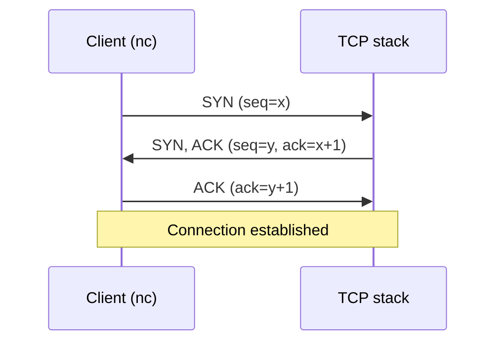
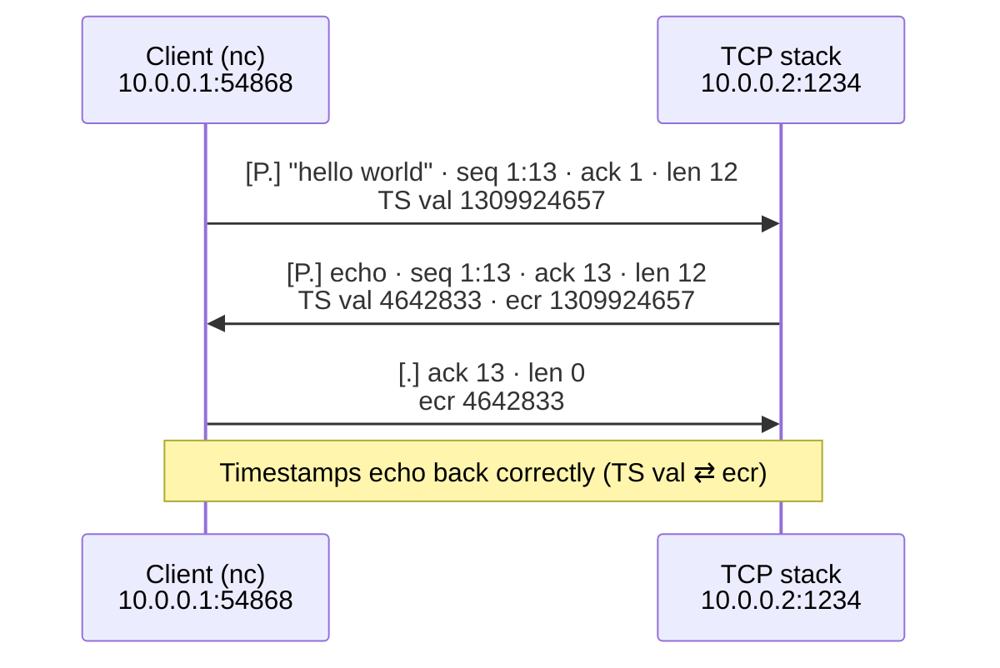
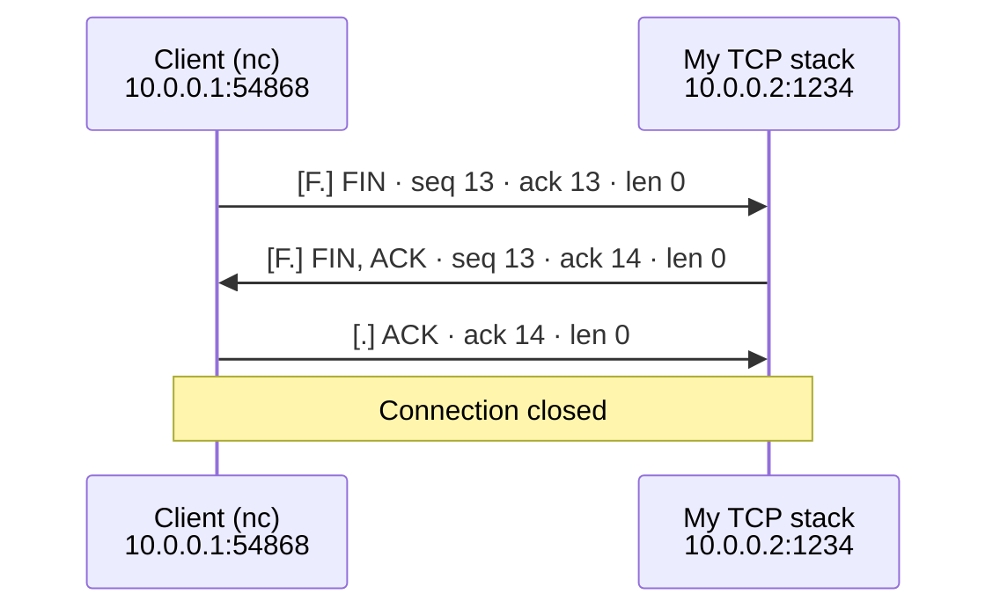

# TCP/IP Stack from Scratch (C++)

A userspace TCP/IP stack written from scratch in modern C++ (C++20). It attaches to a
Linux **TUN** virtual network device, reads raw IP packets off the wire, and implements
the protocols by hand.

## Prerequisites

- A **Linux environment**. The stack uses Linux-only TUN devices (`/dev/net/tun`) and
  `ip`/`sysctl`, so it will **not** build or run on Windows or macOS directly.
  - **On Windows, use WSL2** (Windows Subsystem for Linux). Install it from an
    Administrator PowerShell with `wsl --install`, then reboot and open the "Ubuntu"
    terminal. Everything below is run inside that Linux terminal.
- **CMake** ≥ 3.20
- The **GNU toolchain** (`g++` with C++20 support) — or clang ≥ 12
- `sudo` access (creating a network device is an admin action)
- `tcpdump` for watching packets, and `netcat`/`nc` for testing TCP

### Install the tools (Debian / Ubuntu / WSL)

```bash
sudo apt update
sudo apt install -y build-essential cmake tcpdump netcat-openbsd
```

- `build-essential` — the GNU compiler (`g++`) and `make`
- `cmake` — the build system
- `tcpdump` — packet viewer used to watch the stack work
- `netcat-openbsd` — provides `nc` for testing TCP connections (if that package name
  isn't found on your distro, try `netcat` or `netcat-traditional`)

## What it does

- **IP (IPv4)** — parses and builds IPv4 headers, validates and computes the header checksum.
- **ICMP** — replies to `ping` (echo request → echo reply).
- **TCP** — a real, if minimal, TCP:
  - 3-way handshake (SYN / SYN-ACK / ACK)
  - Tracks each connection by its 4-tuple — *(remote IP, remote port, local IP, local port)* — so several clients can be connected at once, each with its own state
  - Data receive + echo, with correct sequence/acknowledgement accounting
  - TCP options parsing/building: MSS, Window Scale, and **Timestamps**
  - **Retransmission** with an adaptive RTO (RFC 6298: SRTT / RTTVAR) and exponential backoff on repeated timeouts
  - Connection teardown (FIN)
- **poll()**-based event loop, so the program blocks at 0% CPU until a packet arrives or a retransmission timer is due.

## Running it

All commands are run **inside a Linux/WSL terminal**.

### 1. Create the TUN device

Run the setup script **first**. This creates a virtual network card `tun0`, gives it the
address `10.0.0.1/24`, and brings it up. You need to do this once per boot (the device
disappears when WSL/Linux restarts).

```bash
bash setup-tun.sh
```

It will ask for your Linux password because creating a network device is admin-only.

> There is also `tun0.sh`, which does the same setup **and** immediately starts `tcpdump`
> on `tun0` (and disables IPv6 on the device to cut down on noise). Use `setup-tun.sh` if
> you want to run the program in one terminal and `tcpdump` in another.

### 2. Build the project

```bash
cmake -S . -B build
cmake --build build
```

This produces the executable at `build/TCP`.

### 3. Run the stack

```bash
./build/TCP
```

You should see:

```
now listening for packets ...
```

The program is now attached to `tun0` and handling any IP traffic routed to the
`10.0.0.0/24` network.

### 4. Test it

Because `tun0` owns the `10.0.0.0/24` subnet, any address in that range other than
`10.0.0.1` is handled by your stack. Open a **second** Linux terminal:

**Ping (ICMP):**

```bash
ping 10.0.0.3
```

**TCP connect + echo:**

```bash
nc 10.0.0.3 5555
```

Then type a line and press Enter — the stack completes the handshake and echoes your data
back. Press `Ctrl-C` to close the connection (FIN teardown).

### 5. Watch the packets (optional)

In another terminal:

```bash
bash tcpdump.sh
```

(which just runs `sudo tcpdump -i tun0 -n -v`). This shows every packet flowing across the
device — handshakes, data, ACKs, and retransmissions — which is the best way to see the
stack working.

## Walkthrough 
### Establishing a connection — the 3-way handshake

Before any data flows, the client and the stack exchange three packets to agree on
starting sequence numbers:


**1. The client initiates.** Running `nc 10.0.0.3 5555` from a second terminal fires the first SYN:


**2. The exchange, seen on the wire.** `tcpdump` on `tun0` captures all three packets — `[S]` (SYN), `[S.]` (SYN-ACK), `[.]` (ACK):


**3. The stack confirms.** The program logs the completed handshake:


The connection is established after the exchange of syn, syn-ack and ack packets

### Receiving and echoing data

Once the connection is established, anything typed into the client is received by the
stack, acknowledged, and echoed straight back:


**1. Type into the client.** Whatever you send from the `nc` terminal comes straight back — you see your own line echoed underneath it:


**2. The stack logs what it received.** The program prints the payload it pulled off the wire before echoing it:


**3. Correct on the wire.** `tcpdump` shows the echo going back with `seq 1:13` — the same
three bytes, correctly sequenced and acknowledged, no duplication or storm:




### Connection teardown (FIN)

Pressing `Ctrl-C` in the `nc` terminal closes the connection. The client sends a FIN,
the stack replies with its own FIN (piggybacked on the acknowledgement), and the client
acknowledges — three packets, and the connection is fully closed.

**1. Close the client.** `Ctrl-C` sends a FIN-flagged packet signalling the end of the connection:


**2. The stack confirms.** It completes the teardown and reports the connection closed:


**3. The exchange on the wire.** `tcpdump` shows the FIN → FIN-ACK → ACK sequence:




### ICMP ping reply

A quick sanity check that the IP layer works end to end — the stack parses the IPv4 header,
recognises the ICMP echo request, and sends back a valid reply:

```bash
ping 10.0.0.2
```

**Ping from the terminal** — replies come back:


**The stack logs each reply it sends:**


## Notes & limitations

This is a learning project, not a production stack. Known gaps / simplifications:


- Data handling is receive-and-echo; there is no full send-side application API yet.
- **SACK-Permitted / SACK options are not implemented** — only MSS, Window Scale, and Timestamps are parsed and sent.
- **Karn's algorithm is not implemented** — RTT is measured on every ACK, even ACKs that may
  cover a retransmitted segment, which can skew the RTO. Only exponential backoff is in place.
- No congestion control (only retransmission timeout / RTO).
- IPv4 only; IPv6 is disabled on the device.
- Runs against a single TUN device on the `10.0.0.0/24` subnet.
